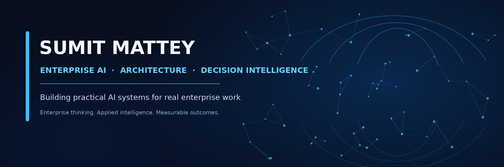

  

# Sumit Mattey

**Enterprise AI, built for decisions and real work.**

I work at the intersection of enterprise architecture, AI, and business transformation—turning emerging technology into practical systems that help teams make better decisions and get meaningful work done.

[LinkedIn](https://www.linkedin.com/in/sumitmattey/) · [GitHub Repositories](https://github.com/mattey2026?tab=repositories)

## Featured projects

| Project | What it is |
|---|---|
| [Growth Intelligence Platform](https://github.com/mattey2026/growth-intelligence-platform) | Claude-powered growth and decision intelligence for exploring accounts, customers, competition, sales, finance, and market opportunities. |
| [Writing Intelligence Studio](https://github.com/mattey2026/writing-intelligence-studio) | A structured editorial workflow for research-led, carefully edited, source-aware long-form writing. |
| [VendorPulse](https://github.com/mattey2026/VendorPulse) | A Salesforce-based procurement renewal tracker designed to replace spreadsheet-led tracking with a more consistent workflow. |
| [ONA Relationship Intelligence](https://github.com/mattey2026/ona-relationship-intelligence) | An evolving project exploring relationship intelligence and connected enterprise workflows. |

## Areas I explore

- Enterprise AI and decision intelligence
- AI agents, Claude skills, and workflow orchestration
- Model Context Protocol (MCP) and enterprise integration
- Salesforce architecture and transformation
- Knowledge systems, memory, and writing workflows

## How I build

- Evidence over guesses
- Useful outcomes over technology theatre
- Human approval for consequential actions
- Observable, testable, reusable systems
- Clear documentation so others can learn, adapt, and contribute

## Explore and contribute

**Use it. Fork it. Improve it.**

Explore the repositories, try what is useful, and share ideas or improvements through issues and pull requests.

## About

I bring 22 years of experience in the Salesforce ecosystem, with a focus on enterprise technology, architecture, and transformation. My current interests centre on making AI useful in real business environments—not just as a chat interface, but as part of how work and decisions happen.
