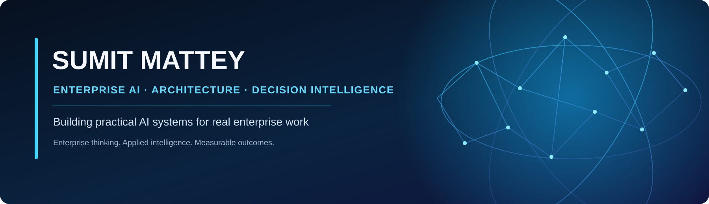

  

<h1 align="center">Sumit Mattey</h1>

  <strong>Enterprise AI • AI Agents • Salesforce Architecture • Decision Intelligence</strong> 
  <em>Building practical AI systems for real enterprise work.</em>

  
  
  
  

---

## About me

I’m an enterprise technology and transformation leader with **22 years in the Salesforce ecosystem**. My work and interests sit at the intersection of **enterprise architecture, business transformation, and applied AI**.

I’m exploring a practical question: **How do we move AI beyond chat interfaces and isolated copilots into systems that understand business context, connect to enterprise tools, and help people make better decisions?**

That question shapes the projects I build and share here—from Claude-powered growth intelligence and structured writing workflows to Salesforce-based operational solutions.

My GitHub is a working portfolio of ideas, experiments, and reusable starting points. I want the work to be understandable, useful, and adaptable—not just impressive in a demo.

## Featured projects — explore, use, fork

<table>
  <tr>
    <td width="50%" valign="top">
      <h3>🚀 <a href="https://github.com/mattey2026/growth-intelligence-platform">Growth Intelligence Platform</a></h3>
      
<strong>Claude-powered enterprise growth and decision intelligence</strong>

      
Explore business questions across accounts, customers, sales, competition, marketing, finance, markets, meetings, and decisions. The ambition is to make business intelligence an interactive decision layer rather than another static dashboard.

      
<strong>Useful for:</strong> Enterprise AI, Claude workflows, AI agents, account intelligence, growth strategy, and decision-support prototypes.

      
<a href="https://github.com/mattey2026/growth-intelligence-platform">View project →</a>

    </td>
    <td width="50%" valign="top">
      <h3>✍️ <a href="https://github.com/mattey2026/writing-intelligence-studio">Writing Intelligence Studio</a></h3>
      
<strong>A multi-stage, research-aware editorial workflow</strong>

      
Uses distinct stages for research, drafting, skeptical editing, copy editing, and fact checking to make long-form writing more deliberate, source-aware, and reviewable than one-shot generation.

      
<strong>Useful for:</strong> Claude skills, research-led writing, editorial automation, content quality, and publishing workflows.

      
<a href="https://github.com/mattey2026/writing-intelligence-studio">View project →</a>

    </td>
  </tr>
  <tr>
    <td width="50%" valign="top">
      <h3>⚙️ <a href="https://github.com/mattey2026/VendorPulse">VendorPulse</a></h3>
      
<strong>Procurement renewal tracking in Salesforce</strong>

      
A Salesforce Lightning Web Component and Apex project focused on purchase-order renewals, renewal status, contract values, reporting, and spreadsheet-based data movement.

      
<strong>Useful for:</strong> Salesforce developers, Lightning Web Components, Apex, procurement workflows, and operational dashboards.

      
<a href="https://github.com/mattey2026/VendorPulse">View project →</a>

    </td>
    <td width="50%" valign="top">
      <h3>🧭 <a href="https://github.com/mattey2026/ona-relationship-intelligence">ONA Relationship Intelligence</a></h3>
      
<strong>Exploring relationship intelligence</strong>

      
An evolving project exploring relationship intelligence and connected enterprise workflows. Follow its development as the concept takes shape.

      
<strong>Useful for:</strong> Connected information, relationship intelligence, and enterprise workflow ideas.

      
<a href="https://github.com/mattey2026/ona-relationship-intelligence">View project →</a>

    </td>
  </tr>
</table>

## Selected writing — Doctor Salesforce

I also publish perspectives on Salesforce architecture, enterprise delivery, and technology transformation through [Doctor Salesforce on Medium](https://medium.com/doctorsalesforce).

- **[Salesforce Headless: A Strategic Repositioning, Not a Revolution](https://medium.com/doctorsalesforce/salesforce-headless-a-strategic-repositioning-not-a-revolution-09248861a105)** — a critical look at the architecture narrative around headless Salesforce.
- **[Salesforce Project Survival Manual — 100 Unspoken Truths](https://medium.com/doctorsalesforce/medium-series-4-part-salesforce-project-management-guide-18befb9de72b)** — lessons on project delivery, technical realities, scope, and governance.
- **[The Ethical Implications of Using AI and Machine Learning in Healthcare](https://medium.com/doctorsalesforce/the-ethical-implications-of-using-ai-and-machine-learning-in-healthcare-603c517d11ab)** — industry-focused thinking about AI, privacy, bias, and transparency.

**Read the ideas. Explore the code. Adapt what works.** I aim to connect practical technology commentary with projects and experiments people can inspect and build on.

## What I’m interested in building

  
  
  
  
  
  
  

- **Enterprise AI and decision intelligence** — connecting business context, evidence, analysis, and action.
- **Claude, skills, and agentic workflows** — building repeatable systems around specialized tasks, not just prompts.
- **MCP and enterprise integration** — exploring how AI can connect to tools and business systems responsibly.
- **Salesforce and enterprise architecture** — applying architecture and integration thinking to real operational needs.
- **Knowledge and writing systems** — making research, context, and quality reusable.

## Principles behind the projects

| Principle | How it shows up in the work |
|---|---|
| Evidence over guesses | Make sources, assumptions, and inputs inspectable. |
| Outcomes over theatre | Solve a concrete workflow or decision problem. |
| Human control where it matters | Keep consequential actions reviewable and approval-driven. |
| Modular and reusable | Make ideas easier to understand, adapt, and extend. |
| Quality is part of the product | Treat testing, evaluation, documentation, and review as core work. |

## Fork it. Adapt it. Build on it.

If a repository helps with a problem you are solving, **fork it and make it useful in your own environment**. Read the project README first, check its current status and license, and start with the smallest piece that creates value.

Ideas, constructive feedback, and contributions are welcome through GitHub issues and pull requests. If you build something interesting from one of these starting points, I’d love to hear what you learned.

  <strong>Build thoughtfully. Share openly. Make AI useful.</strong>

## Find me elsewhere

- 💼 **LinkedIn:** [linkedin.com/in/sumitmattey](https://www.linkedin.com/in/sumitmattey/)
- 📸 **Instagram:** [@sumit.mattey](https://www.instagram.com/sumit.mattey/)
- 💻 **GitHub profile:** [github.com/mattey2026](https://github.com/mattey2026)
- 🚀 **Explore all repositories:** [github.com/mattey2026?tab=repositories](https://github.com/mattey2026?tab=repositories)

---

Enterprise AI · Agentic systems · Salesforce architecture · MCP · Decision intelligence

